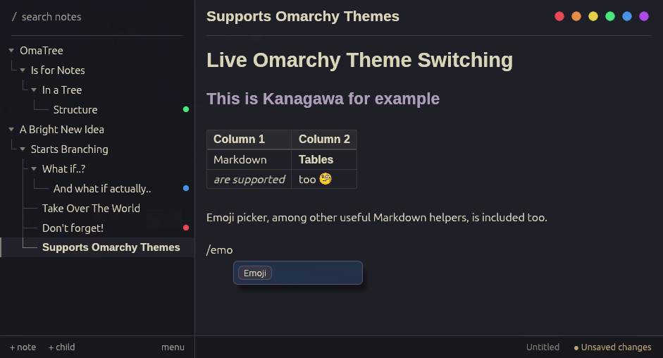
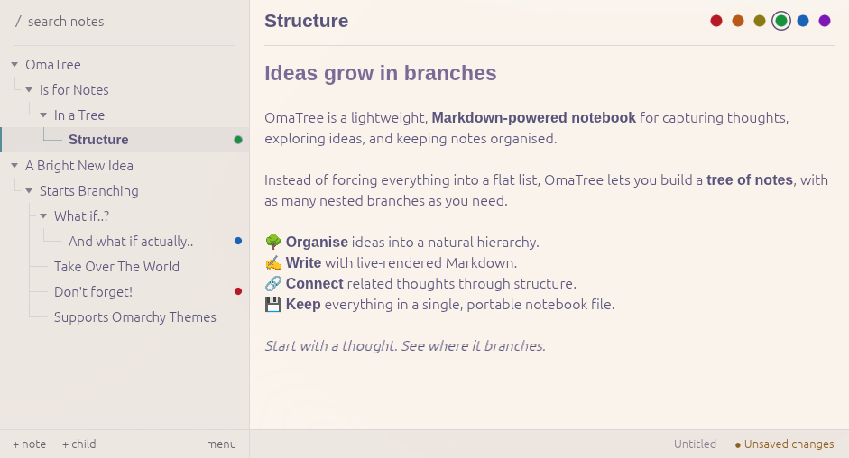
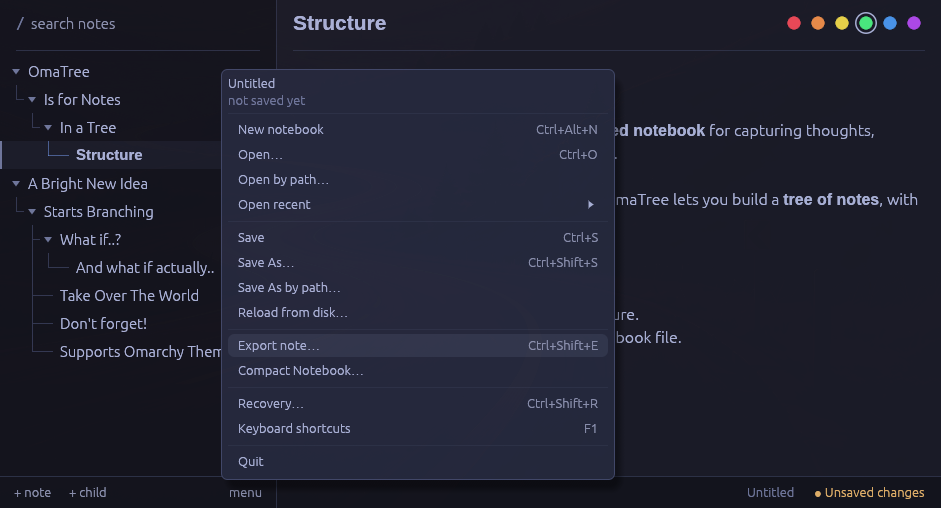

# OmaTree

**A local-first notebook for people who think in trees.** A tree of notes on the left, the selected note on the right, and nothing else in the way. Inspired by CherryTree, designed with [Omarchy](https://omarchy.org) in mind.

Every node is a note, and every note can have child notes, nested as deeply as you like. Notes are Markdown, rendered live while you type. A notebook is one `.omatree` file on your disk.

OmaTree is written in Rust with [egui](https://github.com/emilk/egui). It is a native application: no Electron, no web view, no Qt.



> **Status: pre-release.** This README describes the Rust + egui version, which is developed on the
> `egui-integration` branch and has **not been released yet**. The latest published release is
> [v0.1.2](https://github.com/Dorotabro/OmaTree/releases/tag/v0.1.2), the earlier Qt version. See [Downloads](#downloads-and-installation).

## Features

- **Notes in a tree.** Create, rename, nest, reorder and drag notes with the mouse or the keyboard. Collapse or expand a whole branch at once.
- **Live Markdown.** You edit the Markdown source itself; headings, emphasis, lists, tasks, links, code and emoji are rendered as you type, and the raw syntax appears where the caret is. There is no separate Preview mode.
- **Styled tables.** Markdown tables are drawn as real grids, with bold, italic, code, strikethrough and links inside cells.
- **Images inside the notebook.** Paste an image from the clipboard and it is stored in the notebook file, so the notebook stays one portable file. OmaTree never fetches remote images and never reads arbitrary files from disk.
- **Colour tags.** Mark any note with one of six colours, from the tree menu or the colour picker in the note header. A collapsed branch hints at tagged notes inside it.
- **Search.** The search field is always at the top of the tree; `Ctrl+F` jumps to it. It searches titles and note text.
- **Autosave and recovery.** Deleted notes go to a persistent Trash, structural changes create checkpoints, and *Recovery* restores either.
- **Compact Notebook.** Removes images that no note, Trash entry or checkpoint still uses, after showing you what would go and asking first.
- **Export.** Export a note as Markdown, a folder with its images, a ZIP, or a PDF.
- **Omarchy themes.** On Omarchy, OmaTree follows the current theme and switches live when you change it. Elsewhere it follows the system light or dark setting.
- **Keyboard first.** Everything can be done without the mouse; `F1` lists every shortcut.
- **Local and private.** No account, cloud service, telemetry or network access.

## More screenshots

| Light theme | Notebook menu |
|---|---|
|  |  |

Screenshots of OmaTree on Windows and macOS will be added when builds of the egui version exist for them. See [`docs/screenshots/README.md`](docs/screenshots/README.md).

## Downloads and installation

**There is no download of the egui version yet.** Nothing in this section has been published.

- The latest release, [v0.1.2](https://github.com/Dorotabro/OmaTree/releases/tag/v0.1.2), is the **Qt** version (Linux, macOS on Apple Silicon, Windows x64). Its install instructions are in the [README at that tag](https://github.com/Dorotabro/OmaTree/blob/v0.1.2/README.md).
- The egui version can be **built from source** today (below).
- Linux packages of the egui version (Arch / Omarchy, Debian / Ubuntu, AppImage) can be built with the scripts in `packaging/egui/`; how, and what was and was not verified, is in [`docs/PACKAGING_EGUI.md`](docs/PACKAGING_EGUI.md). They install next to the Qt version and are named `omatree-egui`.
- There are **no Windows or macOS packages** of the egui version (no installer, no `.app`, no disk image).

**Notebook compatibility.** The egui version raises a notebook's schema version only when it has to: to version 4 when an image is saved and to version 5 when a colour tag is saved. Releases up to and including Qt v0.1.2 refuse to open a version 4 or 5 notebook. Keep a copy of any notebook you still need to open with an older version. A notebook is never lowered again, and one that needs neither stays at version 3 and still opens everywhere.

## Getting started

1. Start OmaTree. You get an empty, untitled notebook; nothing is written to disk until you save.
2. `Ctrl+N` creates a note, `Ctrl+Shift+N` a child of the selected note. Type a title, press `Enter`, and write.
3. Type `/` at the start of a line for the slash menu: headings, lists, tasks, code blocks, tables, emoji and images.
4. Press `Ctrl+S`. An untitled notebook asks where to save; OmaTree adds `.omatree` for you. After that, changes are saved automatically.
5. `Ctrl+F` searches, `Escape` returns to the tree, and `F1` shows every shortcut.

To open a notebook directly, pass its path: `omatree-egui path/to/notes.omatree`.

## Keyboard shortcuts

`Ctrl` is `⌘` on macOS. `F1` shows the full list for your platform.

| Keys | Action |
|---|---|
| `Ctrl+N` / `Ctrl+Shift+N` | New note / new child note |
| `F2` | Rename the note |
| `Alt+↑` / `Alt+↓` | Move the note among its siblings |
| `↑` `↓` `←` `→` | Move through the tree, collapse, expand |
| `Ctrl+←` / `Ctrl+→` | Collapse / expand the whole subtree |
| `Enter` | Edit the selected note |
| `Delete` | Move the note to Trash (asks first; on macOS the Delete key) |
| `Shift+F10` | Tree menu, including Colour |
| `Ctrl+F` | Go to search |
| `Ctrl+B` / `Ctrl+I` / `Ctrl+E` | Bold / italic / inline code |
| `Ctrl+Shift+8` / `Ctrl+Shift+7` | Bulleted / numbered list |
| `Ctrl+Enter` | Tick or untick a task |
| `/strike` | Strikethrough (slash menu) |
| `Ctrl+Z` / `Ctrl+Shift+Z` | Undo / redo (per note) |
| `Ctrl+S` / `Ctrl+Shift+S` | Save / Save As |
| `Ctrl+O` / `Ctrl+Alt+N` | Open / new notebook |
| `Ctrl+Shift+E` | Export the note |
| `Ctrl+Shift+R` | Recovery (Trash and checkpoints) |
| `F1` | Keyboard shortcuts |

## Notebook format and portability

A notebook is a single [SQLite](https://sqlite.org) file with the extension `.omatree`, for example `notes.omatree`. It holds the note tree, the note texts (plain Markdown), colour tags, the images you pasted, the Trash and the recovery checkpoints. You can copy it, back it up, sync it with any file tool you already use, or open it with the `sqlite3` command line.

- Images are stored in the notebook and referenced from the Markdown as `assets/<id>.<ext>`. Export to a folder or ZIP writes them out next to the Markdown.
- The notebook is versioned. Older versions of OmaTree refuse a notebook written by a newer schema rather than damage it; see the compatibility note above.
- The list of recent notebooks is the only thing OmaTree stores outside the notebook (a small text file in your configuration directory).

## Omarchy theme integration

On Linux, OmaTree reads the active Omarchy theme from `$XDG_STATE_HOME/omarchy/current/theme/colors.toml` (by default `~/.local/state/omarchy/current/theme/colors.toml`) and re-reads it while running, so switching the theme in Omarchy restyles the open window. If the file is missing or invalid, OmaTree uses its built-in light and dark palettes and follows the system's light or dark preference. Omarchy is never required, and non-Linux platforms never look for it.

## Building from source

You need a Rust toolchain (the project is developed with Rust 1.99; no minimum version is declared) and a C compiler (SQLite is compiled in). **Qt is not needed** for the egui version.

```bash
git clone https://github.com/Dorotabro/OmaTree.git
cd OmaTree
git checkout egui-integration

cargo build --locked --release -p omatree-egui
./target/release/omatree-egui
```

Name the package with `-p omatree-egui`: a plain `cargo build` still builds the Qt application (it is the workspace default until the egui version replaces it). Everything the egui build needs is in this repository (`crates/core`, `crates/editor`, `crates/egui-app`) plus crates from crates.io.

On Linux the window system libraries are loaded at run time: Wayland or X11, EGL/OpenGL, `libxkbcommon`, fontconfig, and `libdbus` for the native file dialogs (through the XDG desktop portal). Without a portal, OmaTree offers to type a path instead.

Before sending changes:

```bash
cargo fmt --all -- --check
cargo clippy --workspace --all-targets -- -D warnings
cargo test --workspace
cargo build --release -p omatree-egui
```

The workspace tests include the Qt package, so Qt 6 must be installed to run all of them. For the egui crates alone use `cargo test -p omatree-core -p omatree-editor -p omatree-egui`. See [`CONTRIBUTING.md`](CONTRIBUTING.md), [`ARCHITECTURE.md`](ARCHITECTURE.md) and [`VISION.md`](VISION.md).

## Supported and unverified platforms

| Platform | State |
|---|---|
| **Linux, Wayland (Omarchy / Hyprland)** | Developed and tested here, including the Arch package (installed into an isolated root, not a real system). |
| Linux, XWayland | Keyboard, mouse, clipboard and rendering checked. |
| Linux, native X11 | **Not verified** (only Xvfb and XWayland were available). |
| Debian 13 / Ubuntu 24.04 (`.deb`) | Installed, started and removed in containers. `.deb` needs glibc 2.39 or newer. |
| AppImage, glibc 2.30+ | Started in Ubuntu 20.04 and Debian 12 containers on X11; native Wayland was checked from the AppImage on the development machine. |
| **macOS (Apple Silicon)** | Runs when built from source (checked on macOS 27). There is **no app bundle or installer**, opening a notebook from Finder is **not implemented**, and the menu bar shows the executable name. |
| **Windows** | **Not verified at run time.** The code type-checks for the MinGW target; it has not been started on Windows, and there is no installer or file association. |
| Screen readers, input methods, Hi-DPI | Not verified. |

Windows and macOS users who want something that works today should use the Qt version from the [v0.1.2 release](https://github.com/Dorotabro/OmaTree/releases/tag/v0.1.2).

## What OmaTree deliberately is not

OmaTree is small on purpose. It has no sync, collaboration, plugins, graph view, AI features or rich-text editing, and it is not meant to grow into a knowledge-management platform. See [`VISION.md`](VISION.md).

## Licence and acknowledgements

OmaTree is licensed under either of

- [Apache License, Version 2.0](LICENSE-APACHE)
- [MIT License](LICENSE-MIT)

at your option.

OmaTree stands on [egui and eframe](https://github.com/emilk/egui), [SQLite](https://sqlite.org), [pulldown-cmark](https://github.com/pulldown-cmark/pulldown-cmark), [krilla](https://github.com/LaurenzV/krilla) (PDF export), [AccessKit](https://github.com/AccessKit/accesskit), [rfd](https://github.com/PolyMeilex/rfd) and many other open-source crates, and bundles the Liberation fonts (SIL Open Font Licence 1.1). Every dependency and its licence is listed in [`THIRD_PARTY.md`](THIRD_PARTY.md); packages ship the full licence texts. OmaTree is inspired by [CherryTree](https://www.giuspen.net/cherrytree/), and its Omarchy integration follows [Omarchy](https://omarchy.org) by DHH and contributors.
